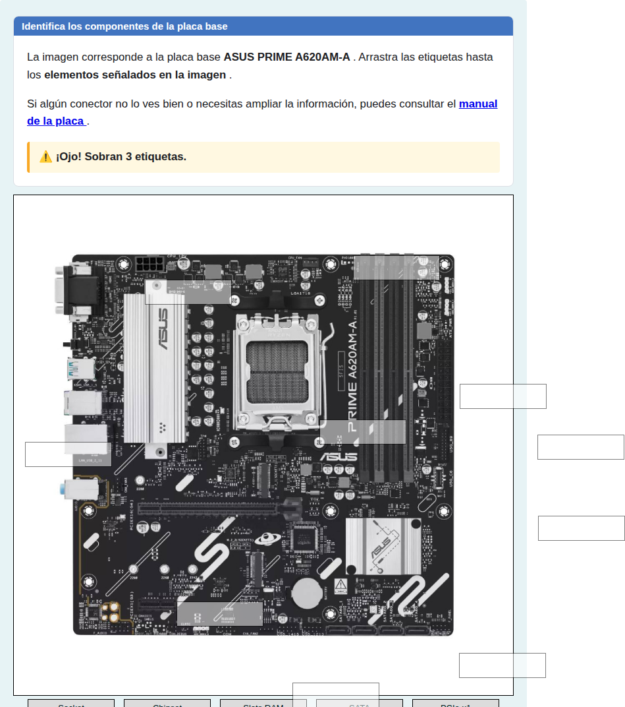
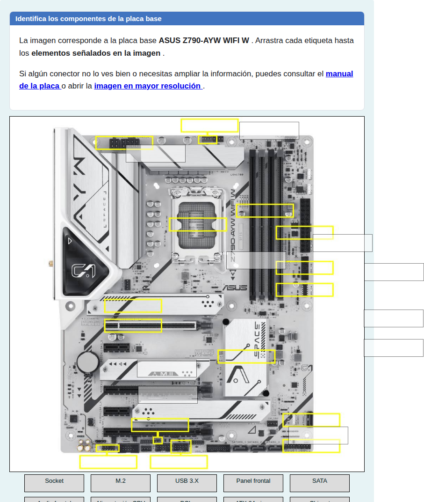
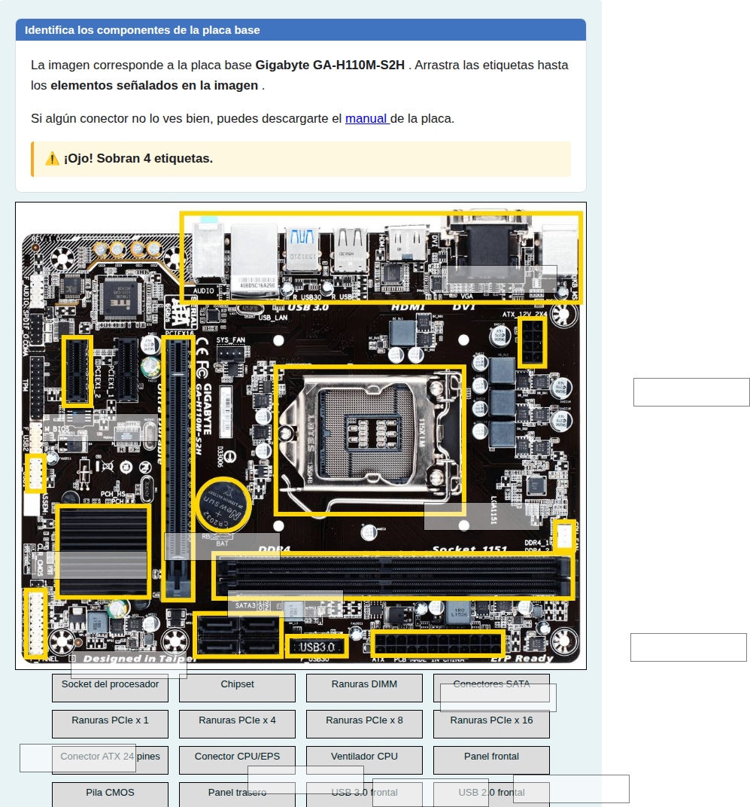
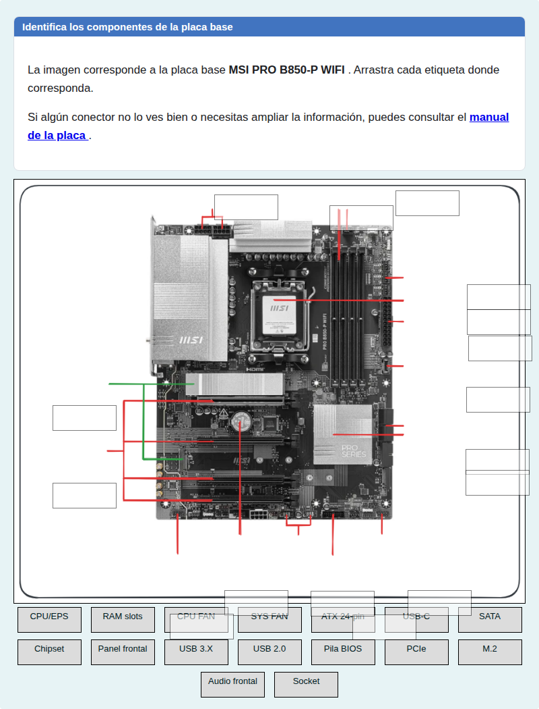
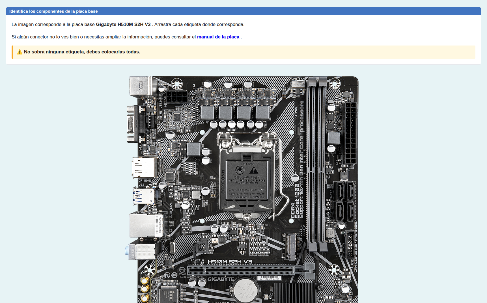
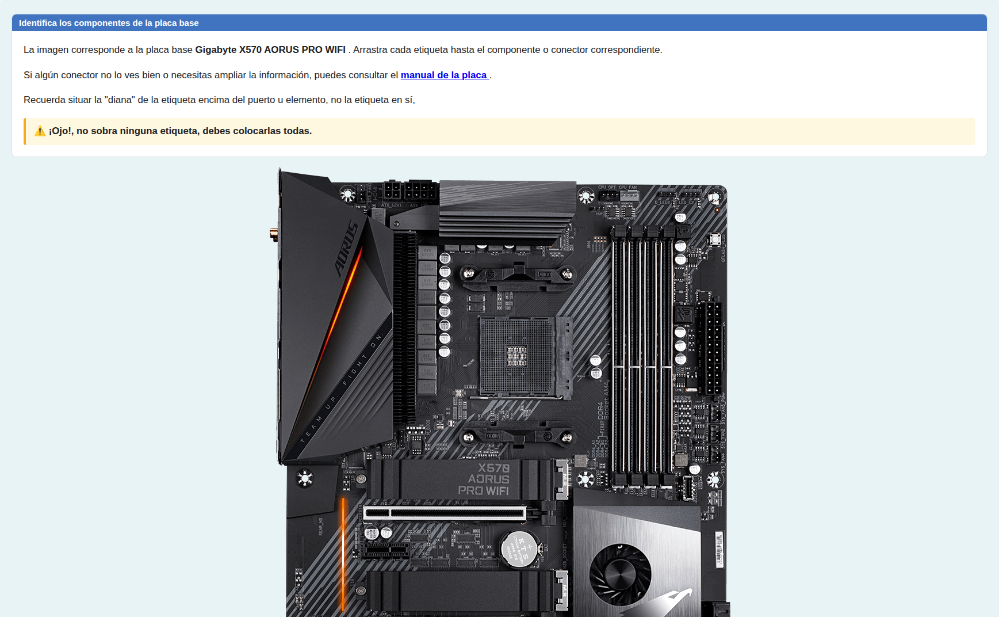

# Componentes de la placa base

Preguntas de arrastrar y soltar para identificar los componentes y conectores de una placa base.

## Contenido

Ficheros de preguntas disponibles en esta actividad:

### [arrastrar-soltar-placa-base.xml](arrastrar-soltar-placa-base.xml)

|   | Tipo              | Cantidad                   |
| - | ----------------- | -------------------------- |
|  | [Arrastrar y soltar imagen o texto](#arrastrar-y-soltar-imagen-o-texto) | 4 |
|  | [Arrastrar y soltar marcador](#arrastrar-y-soltar-marcador) | 2 |
|   | **TOTAL**         | 6 |

#### Arrastrar y soltar imagen o texto

#### Arrastrar y soltar marcador

